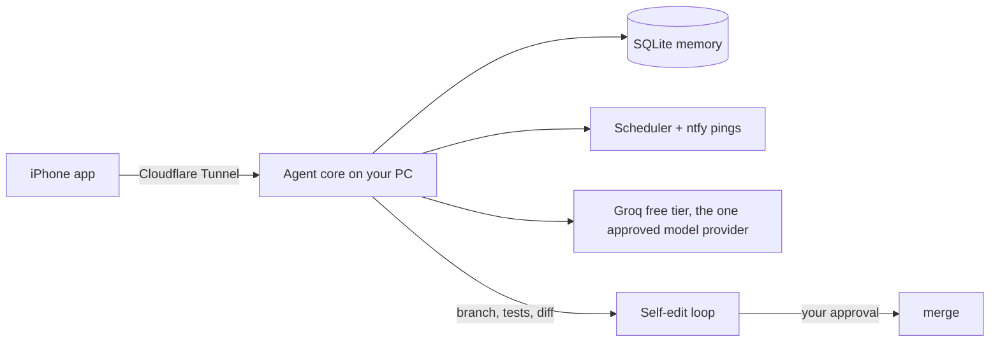

<div align="center">

# Mike


**A personal, proactive, self-improving AI agent. Self-hosted, free, and honest about what it does.**


</div>

---

Mike is two parts:

- **an iPhone app** for chat, approvals and status (sideloaded, no App Store, no paid Apple account)
- **an agent core** running on your own PC: memory, scheduled jobs, model routing and a self-improvement loop with guardrails

Mike itself is free, forever. No subscriptions, no paid APIs, no local models.
The PC runs the agent; free online models do the thinking. Those third-party
free tiers can change their limits over time - if they do, Mike says so and
stops. It never switches to anything paid on its own.

## Run the core on your PC (Linux)

Tested on this repo (bare metal, Python 3.10+):

```bash
git clone https://github.com/federicotaranudev/mike.git
cd mike
python3 -m venv .venv && source .venv/bin/activate
pip install -r requirements.txt
cp .env.example .env   # set MIKE_TOKEN now; GROQ_API_KEY later, once approved
python3 -m pytest tests          # 11 tests should pass
DB_PATH=./mike.db uvicorn agent.api:app --host 127.0.0.1 --port 8787
```

This binds to 127.0.0.1 only, so nothing is reachable from the network yet.
Every endpoint requires `Authorization: Bearer $MIKE_TOKEN` once the token is
set - set it BEFORE any tunnel or port forward exposes the core. Without a key,
chat answers honestly that no model is configured; it never calls a paid API.

A Dockerfile and docker-compose.yml are included for later; that route has not
been tested yet, prefer the commands above for now.

## What "self-improving" means here

No unbounded robot intelligence. Three real mechanisms:

1. **It learns you.** Your corrections and approvals become memory rows it reads back next time.
2. **It improves its own code.** It drafts a change on a git branch, runs the test suite in a networkless container, and shows you the diff. Nothing merges without your yes.
3. **It stays in its lane.** Messaging anyone, spending, posting, or new permissions always require approval. Those rules live in `agent/guardrails.py`, which the self-edit loop is forbidden to touch.

## Architecture



## Model provider

One provider, chosen and approved explicitly: **Groq's free tier** (~1,000 requests/day, 30/min, 200K tokens/day, checked against the Groq docs 25 Oct 2026).

When the day's free quota is spent, **Mike says so and stops**. It never moves your conversations to a different provider on its own, and it never falls back to anything paid. Other providers can be added later, each only after your explicit yes. Gemini's free tier is deliberately not used: Google uses free-tier prompts and responses to improve its products.

## Repo layout

```
agent/
  brain.py       model calls through the one approved provider, fail closed on quota
  memory.py      SQLite memory: preferences, facts, feedback, corrections
  guardrails.py  ask-first rules the agent cannot break (protected from self-edit)
  selfedit.py    branch -> sandboxed tests -> diff -> your approval -> merge
  scheduler.py   proactive jobs that ping you via ntfy
  api.py         FastAPI the iPhone app talks to (tunnel-only)
  notify.py      ntfy push
ios/             the iPhone app (built after the core runs)
tests/           pytest suite the self-edit loop must pass
```

## Run it

```bash
cp .env.example .env   # fill in your free API keys
docker compose up -d
```

The API listens on `127.0.0.1:8787` and is meant to be reached only through a Cloudflare Tunnel.

## Status

**Implemented (v0.1):** single-provider model calls with fail-closed quota, memory with corrections, guardrails, approval API, scheduler skeleton, self-edit safety checks, test suite.

**Planned:** iPhone app, Cloudflare Tunnel setup, real scheduled jobs, the full self-edit loop in the sandbox container, voice notes via Groq Whisper.

## License

MIT - see [LICENSE](LICENSE).
