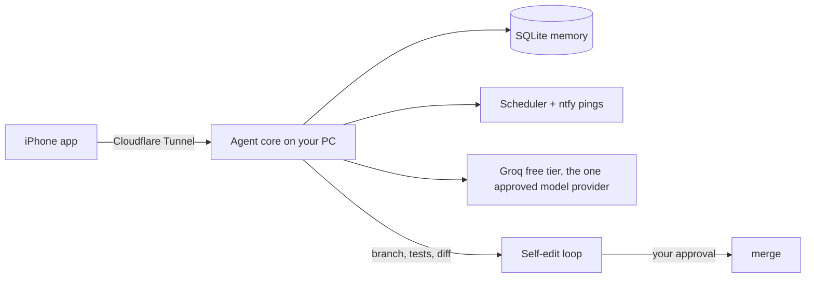

<div align="center">

# Mike


**A personal, proactive, self-improving AI agent. Self-hosted, free, and honest about what it does.**


</div>

---

Mike is two parts:

- **an iPhone app** for chat, approvals and status (sideloaded, no App Store, no paid Apple account)
- **an agent core** running on your own PC: memory, scheduled jobs, model routing and a self-improvement loop with guardrails

No subscriptions, no paid APIs, no local models. The PC runs the agent; free online models do the thinking.

## What "self-improving" means here

No unbounded robot intelligence. Three real mechanisms:

1. **It learns you.** Your corrections and approvals become memory rows it reads back next time.
2. **It improves its own code.** It drafts a change on a git branch, runs the test suite in a networkless container, and shows you the diff. Nothing merges without your yes.
3. **It stays in its lane.** Messaging anyone, spending, posting, or new permissions always require approval. Those rules live in `agent/guardrails.py`, which the self-edit loop is forbidden to touch.

## Architecture



## Model provider

One provider, chosen and approved explicitly: **Groq's free tier** (~1,000 requests/day, 30/min, 200K tokens/day, checked against the Groq docs 25 Oct 2026).

When the day's free quota is spent, **Mike says so and stops**. It never moves your conversations to a different provider on its own, and it never falls back to anything paid. Other providers can be added later, each only after your explicit yes. Gemini's free tier is deliberately not used: Google uses free-tier prompts and responses to improve its products.

## Repo layout

```
agent/
  brain.py       model calls through the one approved provider, fail closed on quota
  memory.py      SQLite memory: preferences, facts, feedback, corrections
  guardrails.py  ask-first rules the agent cannot break (protected from self-edit)
  selfedit.py    branch -> sandboxed tests -> diff -> your approval -> merge
  scheduler.py   proactive jobs that ping you via ntfy
  api.py         FastAPI the iPhone app talks to (tunnel-only)
  notify.py      ntfy push
ios/             the iPhone app (built after the core runs)
tests/           pytest suite the self-edit loop must pass
```

## Run it

```bash
cp .env.example .env   # fill in your free API keys
docker compose up -d
```

The API listens on `127.0.0.1:8787` and is meant to be reached only through a Cloudflare Tunnel.

## Status

**Implemented (v0.1):** single-provider model calls with fail-closed quota, memory with corrections, guardrails, approval API, scheduler skeleton, self-edit safety checks, test suite.

**Planned:** iPhone app, Cloudflare Tunnel setup, real scheduled jobs, the full self-edit loop in the sandbox container, voice notes via Groq Whisper.

## License

No license chosen yet. Private project; all rights reserved by the owner until the user picks one.
